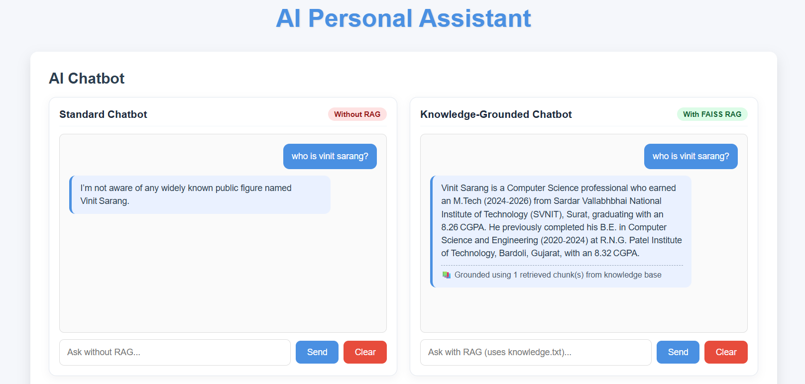

# AI Personal Assistant & Document Analyzer (with FAISS RAG)

**Live Demo:** [https://ai-chatbot-doc-analyzer.onrender.com/](https://ai-chatbot-doc-analyzer.onrender.com/)

A full-stack Flask web application powered by LLMs via the Groq API (`openai/gpt-oss-120b`), featuring a side-by-side **Standard vs. FAISS RAG Chatbot**, an email summarizer, and a PDF/Excel/CSV financial and document analyzer.

## Live Comparison: Without RAG vs. With FAISS RAG



## Key Features
- **Side-by-Side Chatbot Comparison (`/ask` vs. `/ask_rag`):**
  - **Standard Chatbot (Without RAG):** Maintains multi-turn conversation context (date-anchored system prompt + last 10 messages) using only pre-trained LLM weights.
  - **Knowledge-Grounded Chatbot (With FAISS RAG):** Chunks and indexes a local knowledge base (`knowledge.txt`) using TF-IDF embeddings + `FAISS` (`IndexFlatIP` with L2 normalization for cosine similarity), retrieves the top-$k$ relevant chunks per query, and displays the retrieved chunk count alongside each grounded response.
- **Email Summarizer (`/summarize`):** Condenses pasted email threads into a crisp 2–3 sentence summary.
- **PDF & Spreadsheet Extractor with RAG (`/extract`):** Extracts page text and cleaned structured tables from PDFs (`pdfplumber`) as well as sheets/rows from `.xlsx`, `.xls`, and `.csv` files (`pandas`, `openpyxl`). For large documents with custom queries, dynamically chunks and indexes the document in FAISS to retrieve the most relevant sections before generating insights.

## Tech Stack
- **Backend:** Python, Flask, Gunicorn
- **LLM Integration:** Groq API (`https://api.groq.com/openai/v1`) with `openai/gpt-oss-120b`
- **RAG & Vector Search:** `faiss-cpu`, `scikit-learn` (`TfidfVectorizer`), `numpy`
- **Document & Tabular Parsing:** `pdfplumber`, `pandas`, `openpyxl`
- **Frontend:** HTML5, CSS3 (Responsive CSS Grid), Vanilla JavaScript, Marked.js
- **Deployment:** Render

## Project Structure
```text
├── main.py              # Flask application, LLM/RAG endpoints, and PDF/Excel extractors
├── rag.py               # Chunking, TF-IDF vectorization, and FAISS similarity search pipeline
├── knowledge.txt        # Local knowledge base indexed by FAISS for grounded chat
├── requirements.txt     # Python dependencies
├── .gitignore           # Excludes .env, __pycache__, and local IDE files
├── assets/
│   └── rag-demo.png     # Side-by-side Standard vs. RAG comparison screenshot
├── static/
│   ├── style.css        # Responsive split-panel UI and footer styles
│   └── script.js        # Client-side fetch handlers and Markdown rendering
└── templates/
    └── index.html       # Frontend UI layout
```

## RAG Evaluation Benchmarks (`eval_rag.py`)
Evaluated using an LLM-as-a-Judge pipeline (`openai/gpt-oss-120b`) over a golden Q&A set grounded in `knowledge.txt`:

| Metric | Baseline (Merged Chunks, Bigrams, `min_score=0.08`) | Tuned (Paragraph Chunks, Unigrams, `min_score=0.15`) |
| :--- | :---: | :---: |
| **Context Precision** | 0.50 | **1.00** |
| **Context Recall** | 0.75 | **1.00** |
| **Faithfulness** | 1.00 | **1.00** |
| **Answer Relevance** | 0.78 | **1.00** |
| **Avg Retrieval Time** | 1.6 ms | **2.6 ms** |
| **Avg Generation Time** | 808 ms | **999 ms** |
